# Extracted Astrological Charts

- **Source PDF**: `sample.pdf`
- **Pages Scanned**: 56
- **Charts Extracted**: 25
- **Export Resolution**: 300 DPI

> Only authentic astrological charts (e.g. North Indian Kundli charts) are extracted. Advertisements and data tables have been filtered out.

## Table of Contents

1. [Lagna Chart (Page 3)](#chart-1-lagna-chart-page-3)
2. [Navamasa Chart (Page 3)](#chart-2-navamasa-chart-page-3)
3. [Lagna Chart (Page 15)](#chart-3-lagna-chart-page-15)
4. [Varshphal Chart (Solar Return Chart) (Page 16)](#chart-4-varshphal-chart-solar-return-chart-page-16)
5. [Karakamsa Chart (Page 23)](#chart-5-karakamsa-chart-page-23)
6. [Swamsa Chart (Page 23)](#chart-6-swamsa-chart-page-23)
7. [Lagna Chart (Page 34)](#chart-7-lagna-chart-page-34)
8. [Lagna Chart (Page 41)](#chart-8-lagna-chart-page-41)
9. [Hora Wealth (Page 41)](#chart-9-hora-wealth-page-41)
10. [Drekkana - Siblings (Page 41)](#chart-10-drekkana-siblings-page-41)
11. [Chaturthamsha - Luck (Page 41)](#chart-11-chaturthamsha-luck-page-41)
12. [Saptamamsha - Children (Page 41)](#chart-12-saptamamsha-children-page-41)
13. [Navamsha - Spouse (Page 41)](#chart-13-navamsha-spouse-page-41)
14. [Dashamamsha - Profession (Page 42)](#chart-14-dashamamsha-profession-page-42)
15. [Dwadashmamsha - Parents (Page 42)](#chart-15-dwadashmamsha-parents-page-42)
16. [Shodashamsha - Vehicles (Page 42)](#chart-16-shodashamsha-vehicles-page-42)
17. [Vimshamsha - Religious Inclinations (Page 42)](#chart-17-vimshamsha-religious-inclinations-page-42)
18. [Chaturvimshamsha - Education (Page 42)](#chart-18-chaturvimshamsha-education-page-42)
19. [Saptavimshamsha - Strength (Page 42)](#chart-19-saptavimshamsha-strength-page-42)
20. [Trimshamsha - Misfortune (Page 43)](#chart-20-trimshamsha-misfortune-page-43)
21. [Khavedamsha - Auspicious Results (Page 43)](#chart-21-khavedamsha-auspicious-results-page-43)
22. [Akshvedamsha - Well Being (Page 43)](#chart-22-akshvedamsha-well-being-page-43)
23. [Shastiamsha - Well Being (Page 43)](#chart-23-shastiamsha-well-being-page-43)
24. [KP System Chart (Page 44)](#chart-24-kp-system-chart-page-44)
25. [Ashtakvarga Chart (Page 54)](#chart-25-ashtakvarga-chart-page-54)

---

## 1. Lagna Chart — Page 3 

- **Chart Name**: **Lagna Chart**
- **Page**: 3
- **Detection Method**: `vector_kundli_detector`

### House & Planetary Placements

| House | Sign / Rashi | Planets Posited |
| :--- | :--- | :--- |
| **House 1 (Ascendant / Lagna)** | 10 — Capricorn (Makara) | Ne (Neptune) |
| **House 2 (Dhana)** | 11 — Aquarius (Kumbha) | Ra (Rahu (North Node)), Ur (Uranus) |
| **House 3 (Sahaja)** | 12 — Pisces (Meena) | — |
| **House 4 (Sukha / Nadir)** | 1 — Aries (Mesha) | — |
| **House 5 (Putra)** | 2 — Taurus (Vrishabha) | Mo (Moon (Chandra)) |
| **House 6 (Ripu)** | 3 — Gemini (Mithuna) | — |
| **House 7 (Jaya / Descendant)** | 4 — Cancer (Karka) | — |
| **House 8 (Mrityu)** | 5 — Leo (Simha) | Sa (Saturn (Shani)), Ke (Ketu (South Node)) |
| **House 9 (Dharma)** | 6 — Virgo (Kanya) | — |
| **House 10 (Karma / Midheaven)** | 7 — Libra (Tula) | Su (Sun (Surya)), Ma (Mars (Mangal)), Me (Mercury (Budha)), Ve (Venus (Shukra)) |
| **House 11 (Labha)** | 8 — Scorpio (Vrishchika) | Ju (Jupiter (Guru)) |
| **House 12 (Vyaya)** | 9 — Sagittarius (Dhanu) | Pl (Pluto) |

---

## 2. Navamasa Chart — Page 3 

- **Chart Name**: **Navamasa Chart**
- **Page**: 3
- **Detection Method**: `vector_kundli_detector`

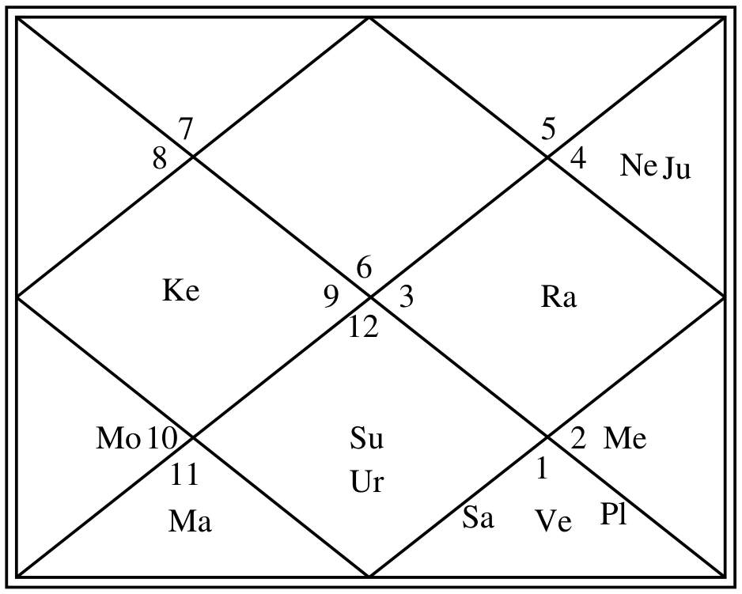

### House & Planetary Placements

| House | Sign / Rashi | Planets Posited |
| :--- | :--- | :--- |
| **House 1 (Ascendant / Lagna)** | 6 — Virgo (Kanya) | — |
| **House 2 (Dhana)** | 7 — Libra (Tula) | — |
| **House 3 (Sahaja)** | 8 — Scorpio (Vrishchika) | — |
| **House 4 (Sukha / Nadir)** | 9 — Sagittarius (Dhanu) | Ke (Ketu (South Node)) |
| **House 5 (Putra)** | 10 — Capricorn (Makara) | Mo (Moon (Chandra)) |
| **House 6 (Ripu)** | 11 — Aquarius (Kumbha) | Ma (Mars (Mangal)) |
| **House 7 (Jaya / Descendant)** | 12 — Pisces (Meena) | Su (Sun (Surya)), Ur (Uranus) |
| **House 8 (Mrityu)** | 1 — Aries (Mesha) | Ve (Venus (Shukra)), Sa (Saturn (Shani)), Pl (Pluto) |
| **House 9 (Dharma)** | 2 — Taurus (Vrishabha) | Me (Mercury (Budha)) |
| **House 10 (Karma / Midheaven)** | 3 — Gemini (Mithuna) | Ra (Rahu (North Node)) |
| **House 11 (Labha)** | 4 — Cancer (Karka) | Ju (Jupiter (Guru)), Ne (Neptune) |
| **House 12 (Vyaya)** | 5 — Leo (Simha) | — |

---

## 3. Lagna Chart — Page 15 

- **Chart Name**: **Lagna Chart**
- **Section / System**: Kalsarpa Dosh
- **Page**: 15
- **Detection Method**: `vector_kundli_detector`

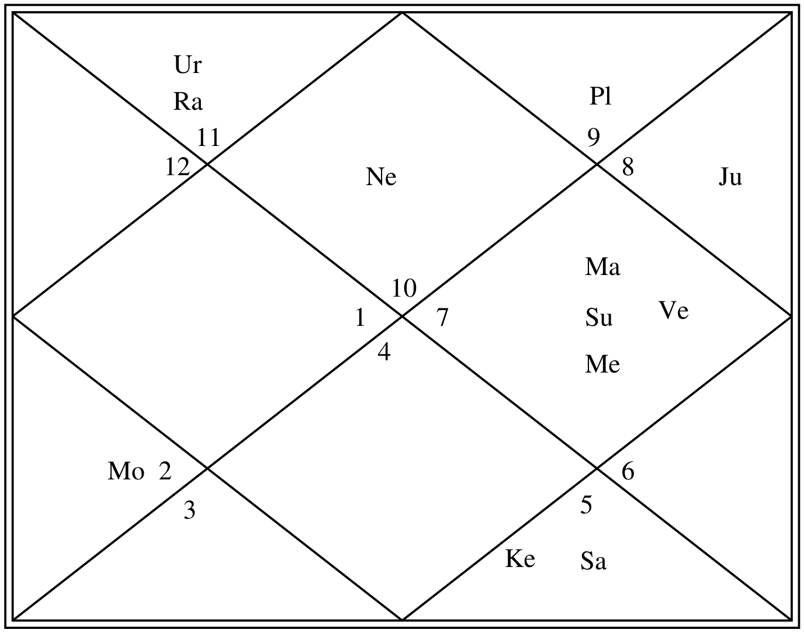

### House & Planetary Placements

| House | Sign / Rashi | Planets Posited |
| :--- | :--- | :--- |
| **House 1 (Ascendant / Lagna)** | 10 — Capricorn (Makara) | Ne (Neptune) |
| **House 2 (Dhana)** | 11 — Aquarius (Kumbha) | Ra (Rahu (North Node)), Ur (Uranus) |
| **House 3 (Sahaja)** | 12 — Pisces (Meena) | — |
| **House 4 (Sukha / Nadir)** | 1 — Aries (Mesha) | — |
| **House 5 (Putra)** | 2 — Taurus (Vrishabha) | Mo (Moon (Chandra)) |
| **House 6 (Ripu)** | 3 — Gemini (Mithuna) | — |
| **House 7 (Jaya / Descendant)** | 4 — Cancer (Karka) | — |
| **House 8 (Mrityu)** | 5 — Leo (Simha) | Sa (Saturn (Shani)), Ke (Ketu (South Node)) |
| **House 9 (Dharma)** | 6 — Virgo (Kanya) | — |
| **House 10 (Karma / Midheaven)** | 7 — Libra (Tula) | Su (Sun (Surya)), Ma (Mars (Mangal)), Me (Mercury (Budha)), Ve (Venus (Shukra)) |
| **House 11 (Labha)** | 8 — Scorpio (Vrishchika) | Ju (Jupiter (Guru)) |
| **House 12 (Vyaya)** | 9 — Sagittarius (Dhanu) | Pl (Pluto) |

---

## 4. Varshphal Chart (Solar Return Chart) — Page 16 

- **Chart Name**: **Varshphal Chart (Solar Return Chart)**
- **Section / System**: Varshaphal (Annual Predictions)  Details
- **Page**: 16
- **Detection Method**: `vector_kundli_detector`

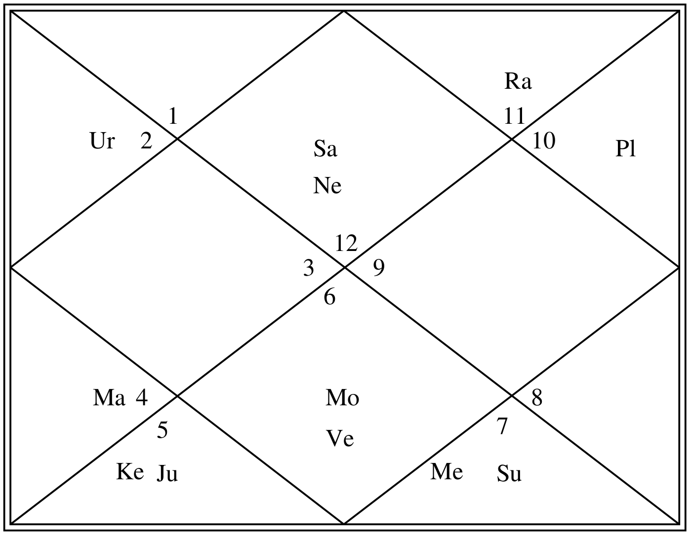

### House & Planetary Placements

| House | Sign / Rashi | Planets Posited |
| :--- | :--- | :--- |
| **House 1 (Ascendant / Lagna)** | 12 — Pisces (Meena) | Sa (Saturn (Shani)), Ne (Neptune) |
| **House 2 (Dhana)** | 1 — Aries (Mesha) | — |
| **House 3 (Sahaja)** | 2 — Taurus (Vrishabha) | Ur (Uranus) |
| **House 4 (Sukha / Nadir)** | 3 — Gemini (Mithuna) | — |
| **House 5 (Putra)** | 4 — Cancer (Karka) | Ma (Mars (Mangal)) |
| **House 6 (Ripu)** | 5 — Leo (Simha) | Ju (Jupiter (Guru)), Ke (Ketu (South Node)) |
| **House 7 (Jaya / Descendant)** | 6 — Virgo (Kanya) | Mo (Moon (Chandra)), Ve (Venus (Shukra)) |
| **House 8 (Mrityu)** | 7 — Libra (Tula) | Su (Sun (Surya)), Me (Mercury (Budha)) |
| **House 9 (Dharma)** | 8 — Scorpio (Vrishchika) | — |
| **House 10 (Karma / Midheaven)** | 9 — Sagittarius (Dhanu) | — |
| **House 11 (Labha)** | 10 — Capricorn (Makara) | Pl (Pluto) |
| **House 12 (Vyaya)** | 11 — Aquarius (Kumbha) | Ra (Rahu (North Node)) |

---

## 5. Karakamsa Chart — Page 23 

- **Chart Name**: **Karakamsa Chart**
- **Section / System**: Jamini System - Karakamsa and Swamsa
- **Page**: 23
- **Detection Method**: `vector_kundli_detector`

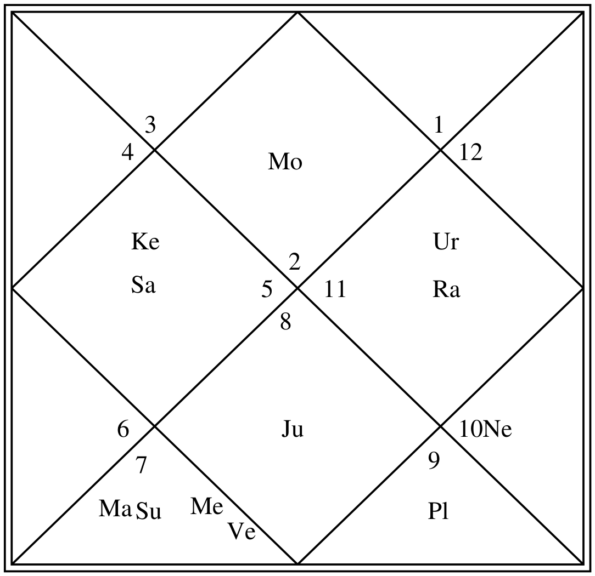

### House & Planetary Placements

| House | Sign / Rashi | Planets Posited |
| :--- | :--- | :--- |
| **House 1 (Ascendant / Lagna)** | 2 — Taurus (Vrishabha) | Mo (Moon (Chandra)) |
| **House 2 (Dhana)** | 3 — Gemini (Mithuna) | — |
| **House 3 (Sahaja)** | 4 — Cancer (Karka) | — |
| **House 4 (Sukha / Nadir)** | 5 — Leo (Simha) | Sa (Saturn (Shani)), Ke (Ketu (South Node)) |
| **House 5 (Putra)** | 6 — Virgo (Kanya) | — |
| **House 6 (Ripu)** | 7 — Libra (Tula) | Su (Sun (Surya)), Ma (Mars (Mangal)), Me (Mercury (Budha)), Ve (Venus (Shukra)) |
| **House 7 (Jaya / Descendant)** | 8 — Scorpio (Vrishchika) | Ju (Jupiter (Guru)) |
| **House 8 (Mrityu)** | 9 — Sagittarius (Dhanu) | Pl (Pluto) |
| **House 9 (Dharma)** | 10 — Capricorn (Makara) | Ne (Neptune) |
| **House 10 (Karma / Midheaven)** | 11 — Aquarius (Kumbha) | Ra (Rahu (North Node)), Ur (Uranus) |
| **House 11 (Labha)** | 12 — Pisces (Meena) | — |
| **House 12 (Vyaya)** | 1 — Aries (Mesha) | — |

---

## 6. Swamsa Chart — Page 23 

- **Chart Name**: **Swamsa Chart**
- **Section / System**: Jamini System - Karakamsa and Swamsa
- **Page**: 23
- **Detection Method**: `vector_kundli_detector`

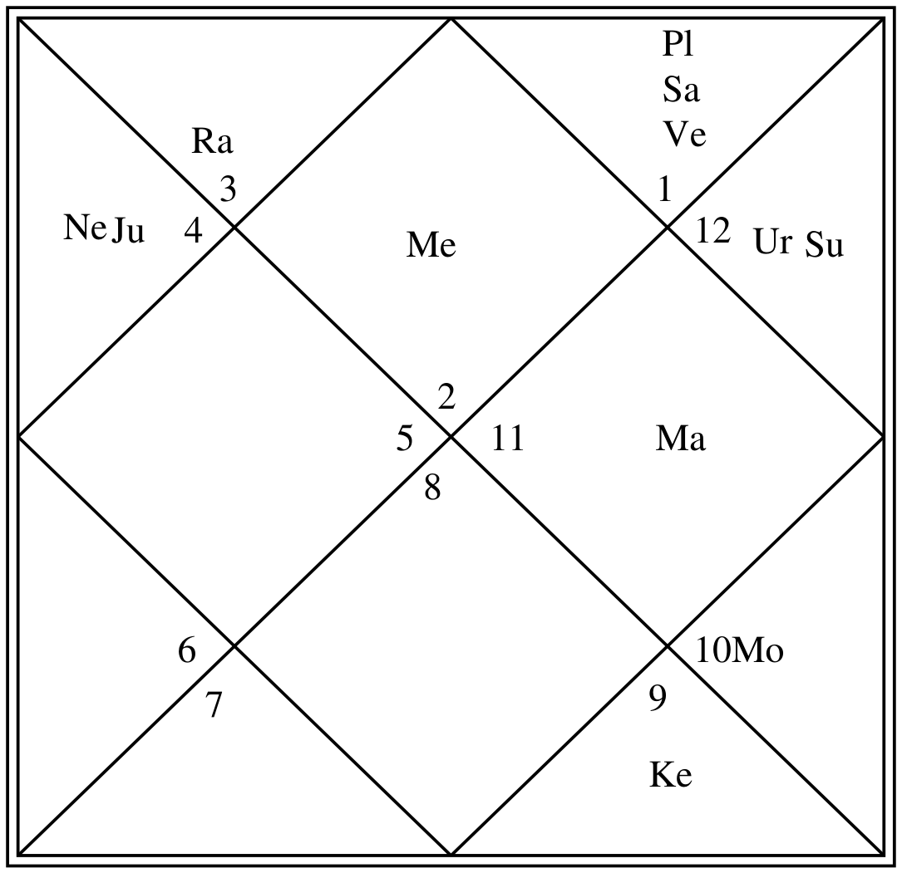

### House & Planetary Placements

| House | Sign / Rashi | Planets Posited |
| :--- | :--- | :--- |
| **House 1 (Ascendant / Lagna)** | 2 — Taurus (Vrishabha) | Me (Mercury (Budha)) |
| **House 2 (Dhana)** | 3 — Gemini (Mithuna) | Ra (Rahu (North Node)) |
| **House 3 (Sahaja)** | 4 — Cancer (Karka) | Ju (Jupiter (Guru)), Ne (Neptune) |
| **House 4 (Sukha / Nadir)** | 5 — Leo (Simha) | — |
| **House 5 (Putra)** | 6 — Virgo (Kanya) | — |
| **House 6 (Ripu)** | 7 — Libra (Tula) | — |
| **House 7 (Jaya / Descendant)** | 8 — Scorpio (Vrishchika) | — |
| **House 8 (Mrityu)** | 9 — Sagittarius (Dhanu) | Ke (Ketu (South Node)) |
| **House 9 (Dharma)** | 10 — Capricorn (Makara) | Mo (Moon (Chandra)) |
| **House 10 (Karma / Midheaven)** | 11 — Aquarius (Kumbha) | Ma (Mars (Mangal)) |
| **House 11 (Labha)** | 12 — Pisces (Meena) | Su (Sun (Surya)), Ur (Uranus) |
| **House 12 (Vyaya)** | 1 — Aries (Mesha) | Ve (Venus (Shukra)), Sa (Saturn (Shani)), Pl (Pluto) |

---

## 7. Lagna Chart — Page 34 

- **Chart Name**: **Lagna Chart**
- **Section / System**: Lal Kitab Calculation
- **Page**: 34
- **Detection Method**: `vector_kundli_detector`

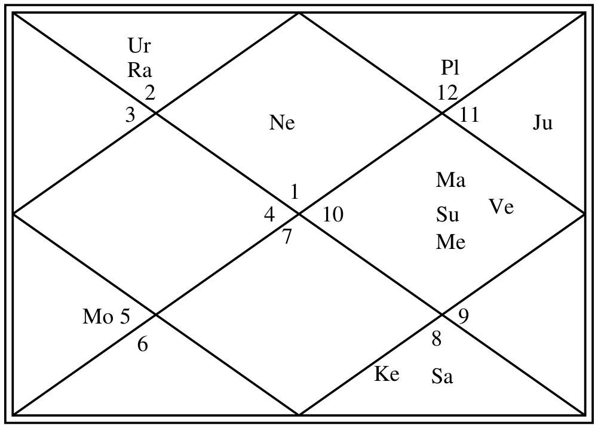

### House & Planetary Placements

| House | Sign / Rashi | Planets Posited |
| :--- | :--- | :--- |
| **House 1 (Ascendant / Lagna)** | 1 — Aries (Mesha) | Ne (Neptune) |
| **House 2 (Dhana)** | 2 — Taurus (Vrishabha) | Ra (Rahu (North Node)), Ur (Uranus) |
| **House 3 (Sahaja)** | 3 — Gemini (Mithuna) | — |
| **House 4 (Sukha / Nadir)** | 4 — Cancer (Karka) | — |
| **House 5 (Putra)** | 5 — Leo (Simha) | Mo (Moon (Chandra)) |
| **House 6 (Ripu)** | 6 — Virgo (Kanya) | — |
| **House 7 (Jaya / Descendant)** | 7 — Libra (Tula) | — |
| **House 8 (Mrityu)** | 8 — Scorpio (Vrishchika) | Sa (Saturn (Shani)), Ke (Ketu (South Node)) |
| **House 9 (Dharma)** | 9 — Sagittarius (Dhanu) | — |
| **House 10 (Karma / Midheaven)** | 10 — Capricorn (Makara) | Su (Sun (Surya)), Ma (Mars (Mangal)), Me (Mercury (Budha)), Ve (Venus (Shukra)) |
| **House 11 (Labha)** | 11 — Aquarius (Kumbha) | Ju (Jupiter (Guru)) |
| **House 12 (Vyaya)** | 12 — Pisces (Meena) | Pl (Pluto) |

---

## 8. Lagna Chart — Page 41 

- **Chart Name**: **Lagna Chart**
- **Section / System**: Shodashvarga Charts
- **Page**: 41
- **Detection Method**: `vector_kundli_detector`

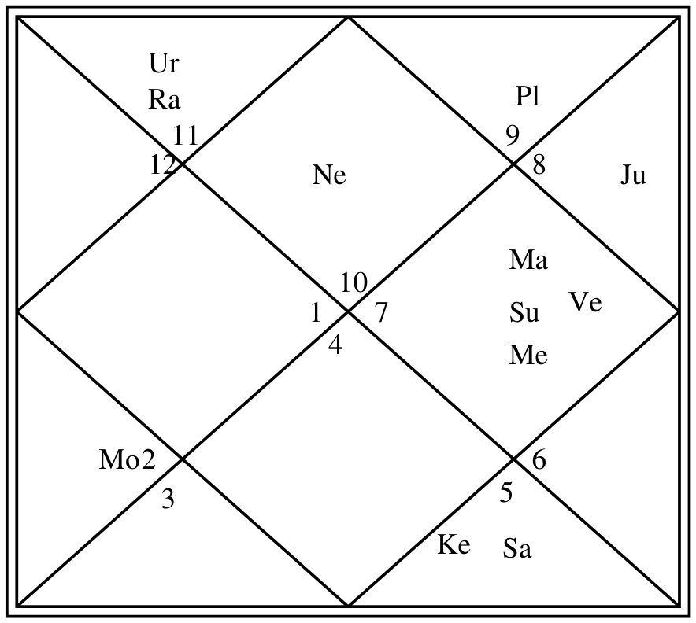

### House & Planetary Placements

| House | Sign / Rashi | Planets Posited |
| :--- | :--- | :--- |
| **House 1 (Ascendant / Lagna)** | 10 — Capricorn (Makara) | Ne (Neptune) |
| **House 2 (Dhana)** | 11 — Aquarius (Kumbha) | Ra (Rahu (North Node)), Ur (Uranus) |
| **House 3 (Sahaja)** | 12 — Pisces (Meena) | — |
| **House 4 (Sukha / Nadir)** | 1 — Aries (Mesha) | — |
| **House 5 (Putra)** | 2 — Taurus (Vrishabha) | Mo (Moon (Chandra)) |
| **House 6 (Ripu)** | 3 — Gemini (Mithuna) | — |
| **House 7 (Jaya / Descendant)** | 4 — Cancer (Karka) | — |
| **House 8 (Mrityu)** | 5 — Leo (Simha) | Sa (Saturn (Shani)), Ke (Ketu (South Node)) |
| **House 9 (Dharma)** | 6 — Virgo (Kanya) | — |
| **House 10 (Karma / Midheaven)** | 7 — Libra (Tula) | Su (Sun (Surya)), Ma (Mars (Mangal)), Me (Mercury (Budha)), Ve (Venus (Shukra)) |
| **House 11 (Labha)** | 8 — Scorpio (Vrishchika) | Ju (Jupiter (Guru)) |
| **House 12 (Vyaya)** | 9 — Sagittarius (Dhanu) | Pl (Pluto) |

---

## 9. Hora Wealth — Page 41 

- **Chart Name**: **Hora Wealth**
- **Section / System**: Shodashvarga Charts
- **Page**: 41
- **Detection Method**: `vector_kundli_detector`

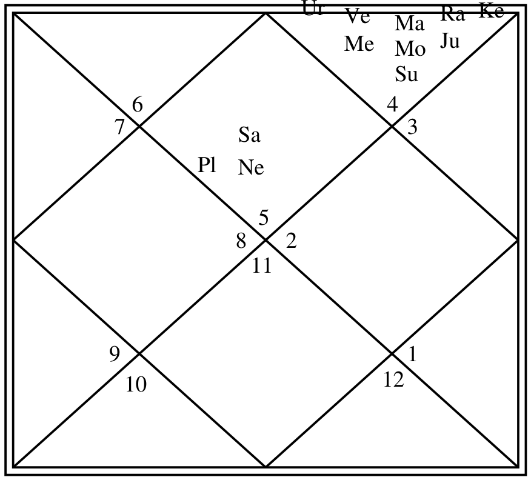

### House & Planetary Placements

| House | Sign / Rashi | Planets Posited |
| :--- | :--- | :--- |
| **House 1 (Ascendant / Lagna)** | 5 — Leo (Simha) | Sa (Saturn (Shani)), Ne (Neptune), Pl (Pluto) |
| **House 2 (Dhana)** | 6 — Virgo (Kanya) | — |
| **House 3 (Sahaja)** | 7 — Libra (Tula) | — |
| **House 4 (Sukha / Nadir)** | 8 — Scorpio (Vrishchika) | — |
| **House 5 (Putra)** | 9 — Sagittarius (Dhanu) | — |
| **House 6 (Ripu)** | 10 — Capricorn (Makara) | — |
| **House 7 (Jaya / Descendant)** | 11 — Aquarius (Kumbha) | — |
| **House 8 (Mrityu)** | 12 — Pisces (Meena) | — |
| **House 9 (Dharma)** | 1 — Aries (Mesha) | — |
| **House 10 (Karma / Midheaven)** | 2 — Taurus (Vrishabha) | — |
| **House 11 (Labha)** | 3 — Gemini (Mithuna) | — |
| **House 12 (Vyaya)** | 4 — Cancer (Karka) | Su (Sun (Surya)), Mo (Moon (Chandra)), Ma (Mars (Mangal)), Me (Mercury (Budha)), Ju (Jupiter (Guru)), Ve (Venus (Shukra)), Ra (Rahu (North Node)) |

---

## 10. Drekkana - Siblings — Page 41 

- **Chart Name**: **Drekkana - Siblings**
- **Section / System**: Shodashvarga Charts
- **Page**: 41
- **Detection Method**: `vector_kundli_detector`

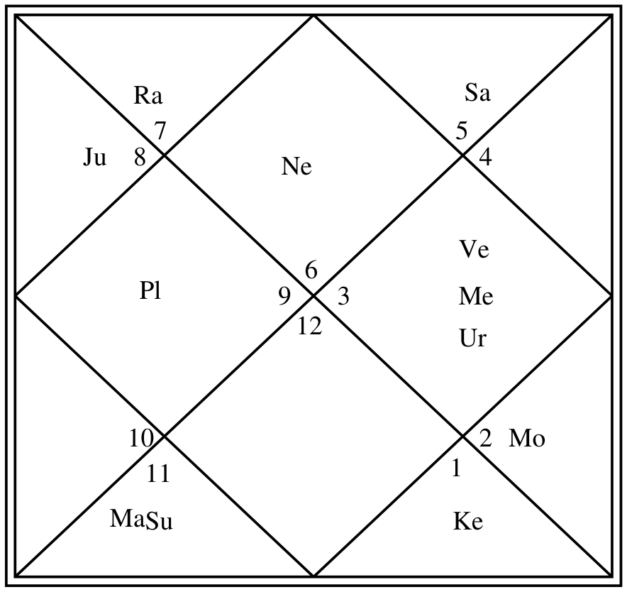

### House & Planetary Placements

| House | Sign / Rashi | Planets Posited |
| :--- | :--- | :--- |
| **House 1 (Ascendant / Lagna)** | 6 — Virgo (Kanya) | Ne (Neptune) |
| **House 2 (Dhana)** | 7 — Libra (Tula) | Ra (Rahu (North Node)) |
| **House 3 (Sahaja)** | 8 — Scorpio (Vrishchika) | Ju (Jupiter (Guru)) |
| **House 4 (Sukha / Nadir)** | 9 — Sagittarius (Dhanu) | Pl (Pluto) |
| **House 5 (Putra)** | 10 — Capricorn (Makara) | — |
| **House 6 (Ripu)** | 11 — Aquarius (Kumbha) | Su (Sun (Surya)), Ma (Mars (Mangal)) |
| **House 7 (Jaya / Descendant)** | 12 — Pisces (Meena) | — |
| **House 8 (Mrityu)** | 1 — Aries (Mesha) | Ke (Ketu (South Node)) |
| **House 9 (Dharma)** | 2 — Taurus (Vrishabha) | Mo (Moon (Chandra)) |
| **House 10 (Karma / Midheaven)** | 3 — Gemini (Mithuna) | Me (Mercury (Budha)), Ve (Venus (Shukra)), Ur (Uranus) |
| **House 11 (Labha)** | 4 — Cancer (Karka) | — |
| **House 12 (Vyaya)** | 5 — Leo (Simha) | Sa (Saturn (Shani)) |

---

## 11. Chaturthamsha - Luck — Page 41 

- **Chart Name**: **Chaturthamsha - Luck**
- **Section / System**: Shodashvarga Charts
- **Page**: 41
- **Detection Method**: `vector_kundli_detector`

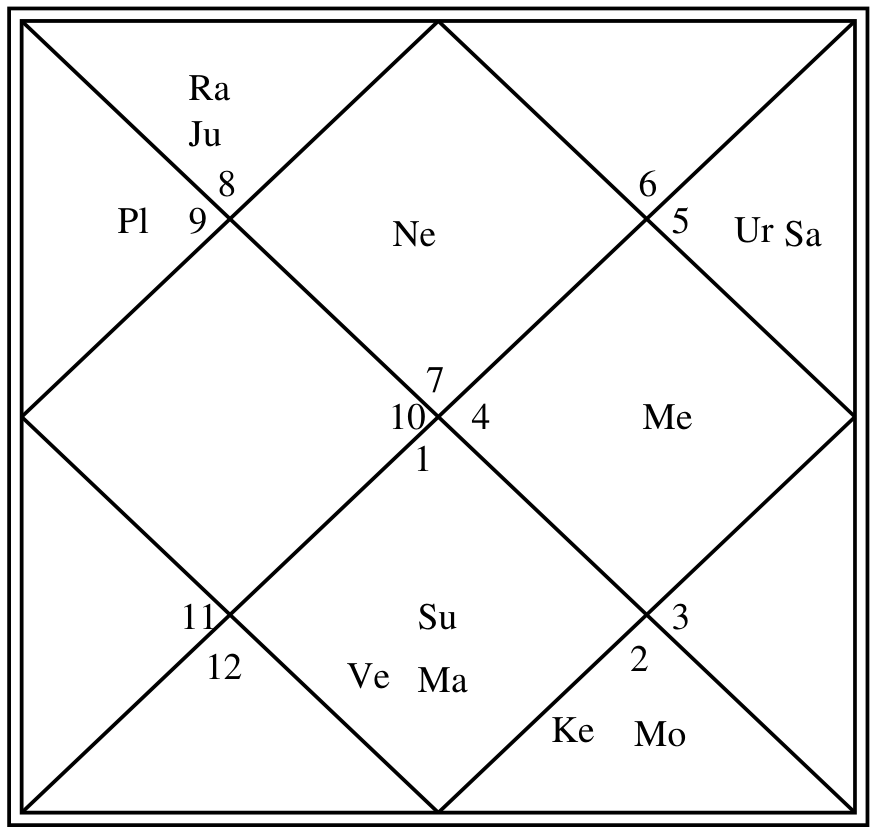

### House & Planetary Placements

| House | Sign / Rashi | Planets Posited |
| :--- | :--- | :--- |
| **House 1 (Ascendant / Lagna)** | 7 — Libra (Tula) | Ne (Neptune) |
| **House 2 (Dhana)** | 8 — Scorpio (Vrishchika) | Ju (Jupiter (Guru)), Ra (Rahu (North Node)) |
| **House 3 (Sahaja)** | 9 — Sagittarius (Dhanu) | Pl (Pluto) |
| **House 4 (Sukha / Nadir)** | 10 — Capricorn (Makara) | — |
| **House 5 (Putra)** | 11 — Aquarius (Kumbha) | — |
| **House 6 (Ripu)** | 12 — Pisces (Meena) | — |
| **House 7 (Jaya / Descendant)** | 1 — Aries (Mesha) | Su (Sun (Surya)), Ma (Mars (Mangal)), Ve (Venus (Shukra)) |
| **House 8 (Mrityu)** | 2 — Taurus (Vrishabha) | Mo (Moon (Chandra)), Ke (Ketu (South Node)) |
| **House 9 (Dharma)** | 3 — Gemini (Mithuna) | — |
| **House 10 (Karma / Midheaven)** | 4 — Cancer (Karka) | Me (Mercury (Budha)) |
| **House 11 (Labha)** | 5 — Leo (Simha) | Sa (Saturn (Shani)), Ur (Uranus) |
| **House 12 (Vyaya)** | 6 — Virgo (Kanya) | — |

---

## 12. Saptamamsha - Children — Page 41 

- **Chart Name**: **Saptamamsha - Children**
- **Section / System**: Shodashvarga Charts
- **Page**: 41
- **Detection Method**: `vector_kundli_detector`

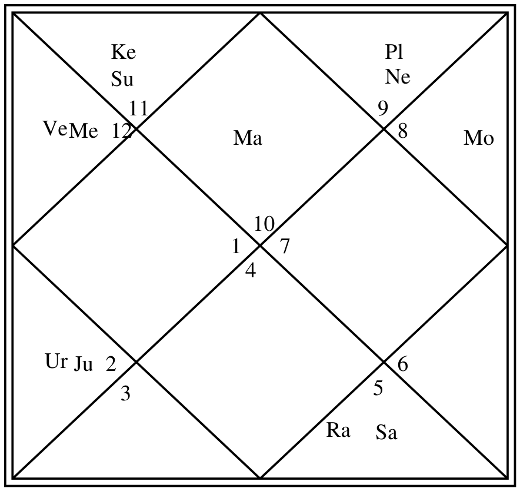

### House & Planetary Placements

| House | Sign / Rashi | Planets Posited |
| :--- | :--- | :--- |
| **House 1 (Ascendant / Lagna)** | 10 — Capricorn (Makara) | Ma (Mars (Mangal)) |
| **House 2 (Dhana)** | 11 — Aquarius (Kumbha) | Su (Sun (Surya)), Ke (Ketu (South Node)) |
| **House 3 (Sahaja)** | 12 — Pisces (Meena) | Me (Mercury (Budha)), Ve (Venus (Shukra)) |
| **House 4 (Sukha / Nadir)** | 1 — Aries (Mesha) | — |
| **House 5 (Putra)** | 2 — Taurus (Vrishabha) | Ju (Jupiter (Guru)), Ur (Uranus) |
| **House 6 (Ripu)** | 3 — Gemini (Mithuna) | — |
| **House 7 (Jaya / Descendant)** | 4 — Cancer (Karka) | — |
| **House 8 (Mrityu)** | 5 — Leo (Simha) | Sa (Saturn (Shani)), Ra (Rahu (North Node)) |
| **House 9 (Dharma)** | 6 — Virgo (Kanya) | — |
| **House 10 (Karma / Midheaven)** | 7 — Libra (Tula) | — |
| **House 11 (Labha)** | 8 — Scorpio (Vrishchika) | Mo (Moon (Chandra)) |
| **House 12 (Vyaya)** | 9 — Sagittarius (Dhanu) | Ne (Neptune), Pl (Pluto) |

---

## 13. Navamsha - Spouse — Page 41 

- **Chart Name**: **Navamsha - Spouse**
- **Section / System**: Shodashvarga Charts
- **Page**: 41
- **Detection Method**: `vector_kundli_detector`

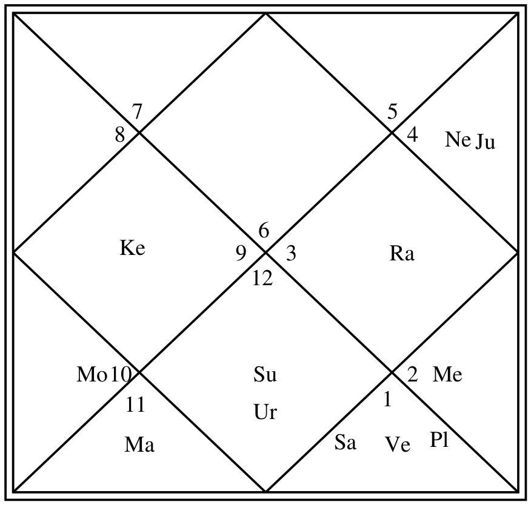

### House & Planetary Placements

| House | Sign / Rashi | Planets Posited |
| :--- | :--- | :--- |
| **House 1 (Ascendant / Lagna)** | 6 — Virgo (Kanya) | — |
| **House 2 (Dhana)** | 7 — Libra (Tula) | — |
| **House 3 (Sahaja)** | 8 — Scorpio (Vrishchika) | — |
| **House 4 (Sukha / Nadir)** | 9 — Sagittarius (Dhanu) | Ke (Ketu (South Node)) |
| **House 5 (Putra)** | 10 — Capricorn (Makara) | Mo (Moon (Chandra)) |
| **House 6 (Ripu)** | 11 — Aquarius (Kumbha) | Ma (Mars (Mangal)) |
| **House 7 (Jaya / Descendant)** | 12 — Pisces (Meena) | Su (Sun (Surya)), Ur (Uranus) |
| **House 8 (Mrityu)** | 1 — Aries (Mesha) | Ve (Venus (Shukra)), Sa (Saturn (Shani)), Pl (Pluto) |
| **House 9 (Dharma)** | 2 — Taurus (Vrishabha) | Me (Mercury (Budha)) |
| **House 10 (Karma / Midheaven)** | 3 — Gemini (Mithuna) | Ra (Rahu (North Node)) |
| **House 11 (Labha)** | 4 — Cancer (Karka) | Ju (Jupiter (Guru)), Ne (Neptune) |
| **House 12 (Vyaya)** | 5 — Leo (Simha) | — |

---

## 14. Dashamamsha - Profession — Page 42 

- **Chart Name**: **Dashamamsha - Profession**
- **Section / System**: Shodashvarga Charts
- **Page**: 42
- **Detection Method**: `vector_kundli_detector`

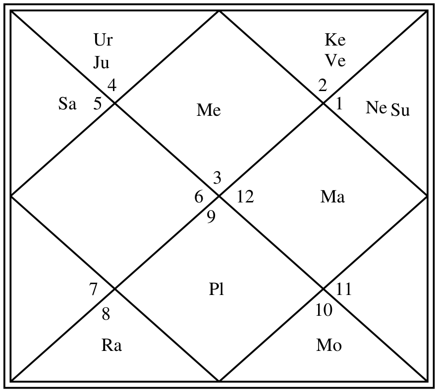

### House & Planetary Placements

| House | Sign / Rashi | Planets Posited |
| :--- | :--- | :--- |
| **House 1 (Ascendant / Lagna)** | 3 — Gemini (Mithuna) | Me (Mercury (Budha)) |
| **House 2 (Dhana)** | 4 — Cancer (Karka) | Ju (Jupiter (Guru)), Ur (Uranus) |
| **House 3 (Sahaja)** | 5 — Leo (Simha) | Sa (Saturn (Shani)) |
| **House 4 (Sukha / Nadir)** | 6 — Virgo (Kanya) | — |
| **House 5 (Putra)** | 7 — Libra (Tula) | — |
| **House 6 (Ripu)** | 8 — Scorpio (Vrishchika) | Ra (Rahu (North Node)) |
| **House 7 (Jaya / Descendant)** | 9 — Sagittarius (Dhanu) | Pl (Pluto) |
| **House 8 (Mrityu)** | 10 — Capricorn (Makara) | Mo (Moon (Chandra)) |
| **House 9 (Dharma)** | 11 — Aquarius (Kumbha) | — |
| **House 10 (Karma / Midheaven)** | 12 — Pisces (Meena) | Ma (Mars (Mangal)) |
| **House 11 (Labha)** | 1 — Aries (Mesha) | Su (Sun (Surya)), Ne (Neptune) |
| **House 12 (Vyaya)** | 2 — Taurus (Vrishabha) | Ve (Venus (Shukra)), Ke (Ketu (South Node)) |

---

## 15. Dwadashmamsha - Parents — Page 42 

- **Chart Name**: **Dwadashmamsha - Parents**
- **Section / System**: Shodashvarga Charts
- **Page**: 42
- **Detection Method**: `vector_kundli_detector`

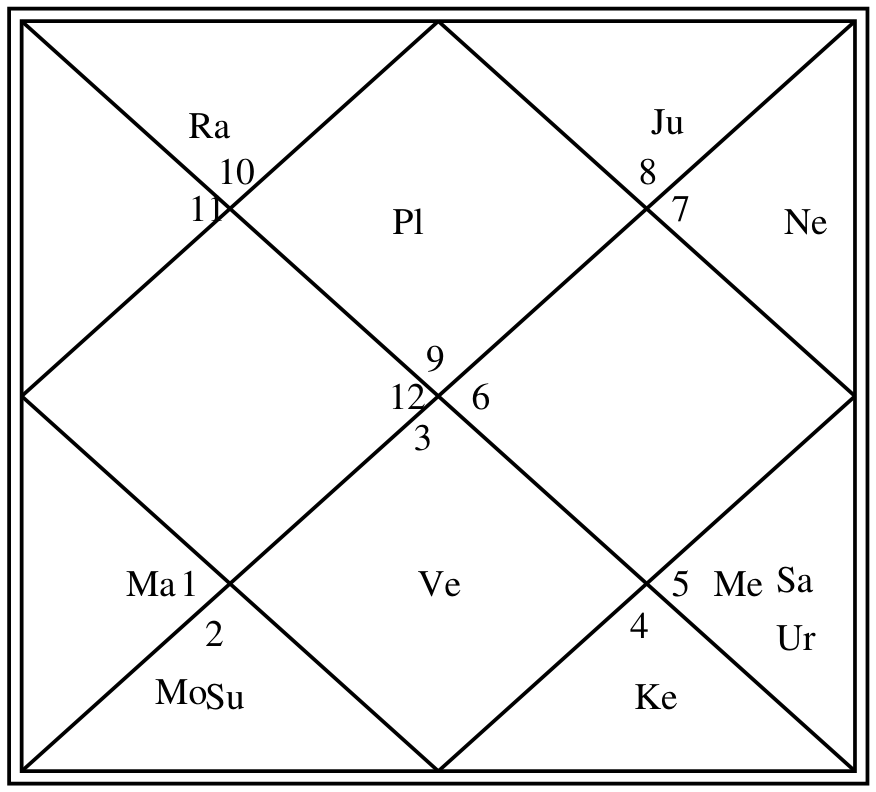

### House & Planetary Placements

| House | Sign / Rashi | Planets Posited |
| :--- | :--- | :--- |
| **House 1 (Ascendant / Lagna)** | 9 — Sagittarius (Dhanu) | Pl (Pluto) |
| **House 2 (Dhana)** | 10 — Capricorn (Makara) | Ra (Rahu (North Node)) |
| **House 3 (Sahaja)** | 11 — Aquarius (Kumbha) | — |
| **House 4 (Sukha / Nadir)** | 12 — Pisces (Meena) | — |
| **House 5 (Putra)** | 1 — Aries (Mesha) | Ma (Mars (Mangal)) |
| **House 6 (Ripu)** | 2 — Taurus (Vrishabha) | Su (Sun (Surya)), Mo (Moon (Chandra)) |
| **House 7 (Jaya / Descendant)** | 3 — Gemini (Mithuna) | Ve (Venus (Shukra)) |
| **House 8 (Mrityu)** | 4 — Cancer (Karka) | Ke (Ketu (South Node)) |
| **House 9 (Dharma)** | 5 — Leo (Simha) | Me (Mercury (Budha)), Sa (Saturn (Shani)), Ur (Uranus) |
| **House 10 (Karma / Midheaven)** | 6 — Virgo (Kanya) | — |
| **House 11 (Labha)** | 7 — Libra (Tula) | Ne (Neptune) |
| **House 12 (Vyaya)** | 8 — Scorpio (Vrishchika) | Ju (Jupiter (Guru)) |

---

## 16. Shodashamsha - Vehicles — Page 42 

- **Chart Name**: **Shodashamsha - Vehicles**
- **Section / System**: Shodashvarga Charts
- **Page**: 42
- **Detection Method**: `vector_kundli_detector`

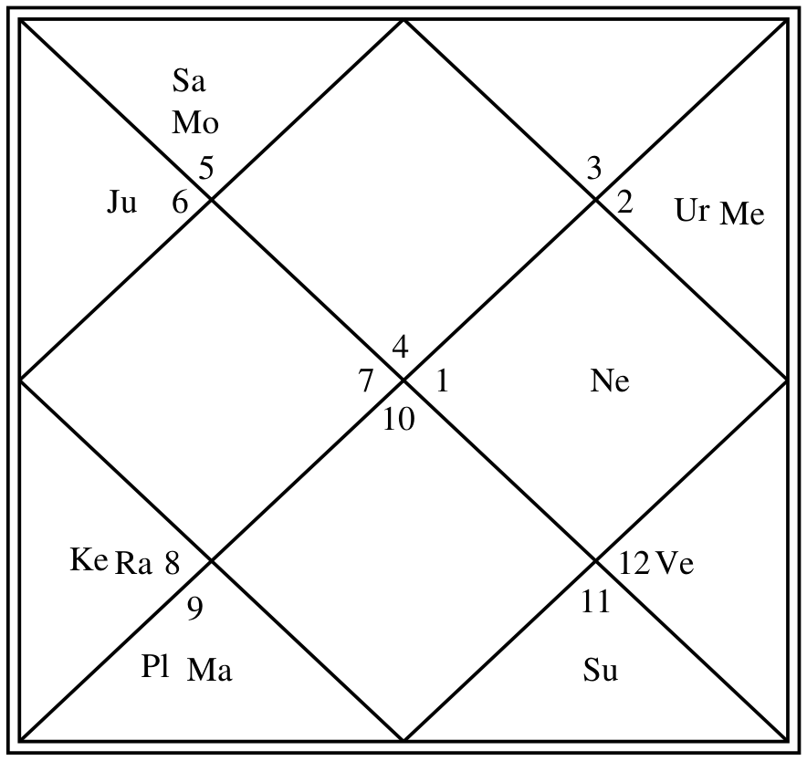

### House & Planetary Placements

| House | Sign / Rashi | Planets Posited |
| :--- | :--- | :--- |
| **House 1 (Ascendant / Lagna)** | 4 — Cancer (Karka) | — |
| **House 2 (Dhana)** | 5 — Leo (Simha) | Mo (Moon (Chandra)), Sa (Saturn (Shani)) |
| **House 3 (Sahaja)** | 6 — Virgo (Kanya) | Ju (Jupiter (Guru)) |
| **House 4 (Sukha / Nadir)** | 7 — Libra (Tula) | — |
| **House 5 (Putra)** | 8 — Scorpio (Vrishchika) | Ra (Rahu (North Node)), Ke (Ketu (South Node)) |
| **House 6 (Ripu)** | 9 — Sagittarius (Dhanu) | Ma (Mars (Mangal)), Pl (Pluto) |
| **House 7 (Jaya / Descendant)** | 10 — Capricorn (Makara) | — |
| **House 8 (Mrityu)** | 11 — Aquarius (Kumbha) | Su (Sun (Surya)) |
| **House 9 (Dharma)** | 12 — Pisces (Meena) | Ve (Venus (Shukra)) |
| **House 10 (Karma / Midheaven)** | 1 — Aries (Mesha) | Ne (Neptune) |
| **House 11 (Labha)** | 2 — Taurus (Vrishabha) | Me (Mercury (Budha)), Ur (Uranus) |
| **House 12 (Vyaya)** | 3 — Gemini (Mithuna) | — |

---

## 17. Vimshamsha - Religious Inclinations — Page 42 

- **Chart Name**: **Vimshamsha - Religious Inclinations**
- **Section / System**: Shodashvarga Charts
- **Page**: 42
- **Detection Method**: `vector_kundli_detector`

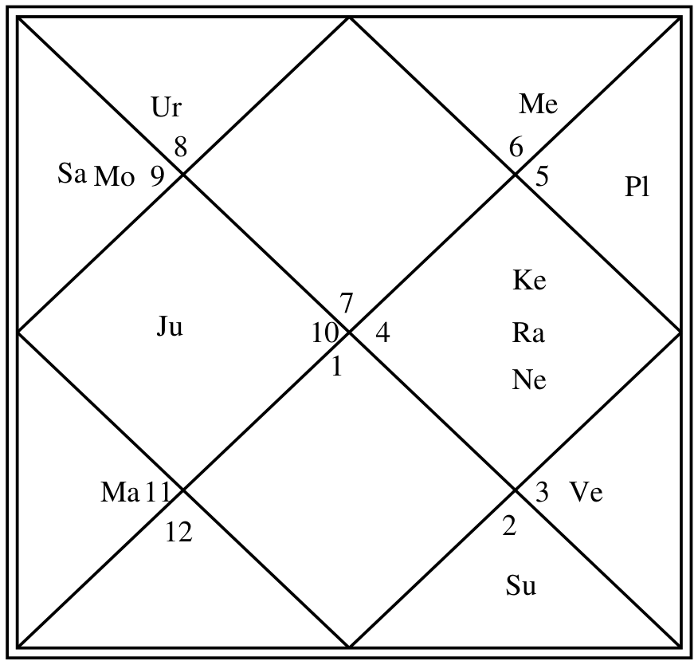

### House & Planetary Placements

| House | Sign / Rashi | Planets Posited |
| :--- | :--- | :--- |
| **House 1 (Ascendant / Lagna)** | 7 — Libra (Tula) | — |
| **House 2 (Dhana)** | 8 — Scorpio (Vrishchika) | Ur (Uranus) |
| **House 3 (Sahaja)** | 9 — Sagittarius (Dhanu) | Mo (Moon (Chandra)), Sa (Saturn (Shani)) |
| **House 4 (Sukha / Nadir)** | 10 — Capricorn (Makara) | Ju (Jupiter (Guru)) |
| **House 5 (Putra)** | 11 — Aquarius (Kumbha) | Ma (Mars (Mangal)) |
| **House 6 (Ripu)** | 12 — Pisces (Meena) | — |
| **House 7 (Jaya / Descendant)** | 1 — Aries (Mesha) | — |
| **House 8 (Mrityu)** | 2 — Taurus (Vrishabha) | Su (Sun (Surya)) |
| **House 9 (Dharma)** | 3 — Gemini (Mithuna) | Ve (Venus (Shukra)) |
| **House 10 (Karma / Midheaven)** | 4 — Cancer (Karka) | Ra (Rahu (North Node)), Ke (Ketu (South Node)), Ne (Neptune) |
| **House 11 (Labha)** | 5 — Leo (Simha) | Pl (Pluto) |
| **House 12 (Vyaya)** | 6 — Virgo (Kanya) | Me (Mercury (Budha)) |

---

## 18. Chaturvimshamsha - Education — Page 42 

- **Chart Name**: **Chaturvimshamsha - Education**
- **Section / System**: Shodashvarga Charts
- **Page**: 42
- **Detection Method**: `vector_kundli_detector`

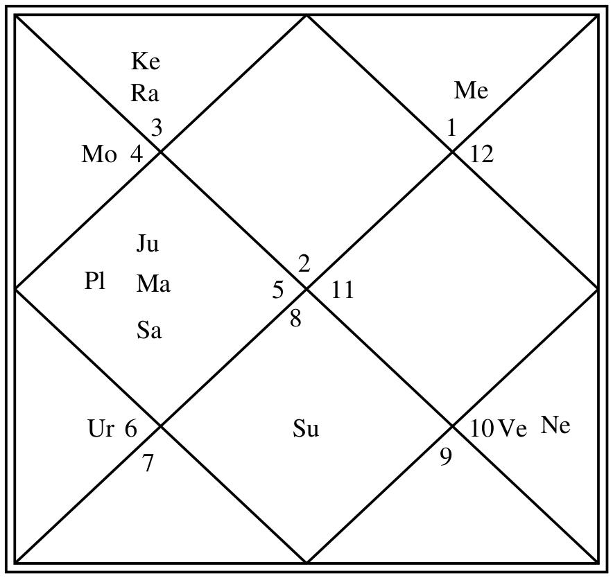

### House & Planetary Placements

| House | Sign / Rashi | Planets Posited |
| :--- | :--- | :--- |
| **House 1 (Ascendant / Lagna)** | 2 — Taurus (Vrishabha) | — |
| **House 2 (Dhana)** | 3 — Gemini (Mithuna) | Ra (Rahu (North Node)), Ke (Ketu (South Node)) |
| **House 3 (Sahaja)** | 4 — Cancer (Karka) | Mo (Moon (Chandra)) |
| **House 4 (Sukha / Nadir)** | 5 — Leo (Simha) | Ma (Mars (Mangal)), Ju (Jupiter (Guru)), Sa (Saturn (Shani)), Pl (Pluto) |
| **House 5 (Putra)** | 6 — Virgo (Kanya) | Ur (Uranus) |
| **House 6 (Ripu)** | 7 — Libra (Tula) | — |
| **House 7 (Jaya / Descendant)** | 8 — Scorpio (Vrishchika) | Su (Sun (Surya)) |
| **House 8 (Mrityu)** | 9 — Sagittarius (Dhanu) | — |
| **House 9 (Dharma)** | 10 — Capricorn (Makara) | Ve (Venus (Shukra)), Ne (Neptune) |
| **House 10 (Karma / Midheaven)** | 11 — Aquarius (Kumbha) | — |
| **House 11 (Labha)** | 12 — Pisces (Meena) | — |
| **House 12 (Vyaya)** | 1 — Aries (Mesha) | Me (Mercury (Budha)) |

---

## 19. Saptavimshamsha - Strength — Page 42 

- **Chart Name**: **Saptavimshamsha - Strength**
- **Section / System**: Shodashvarga Charts
- **Page**: 42
- **Detection Method**: `vector_kundli_detector`

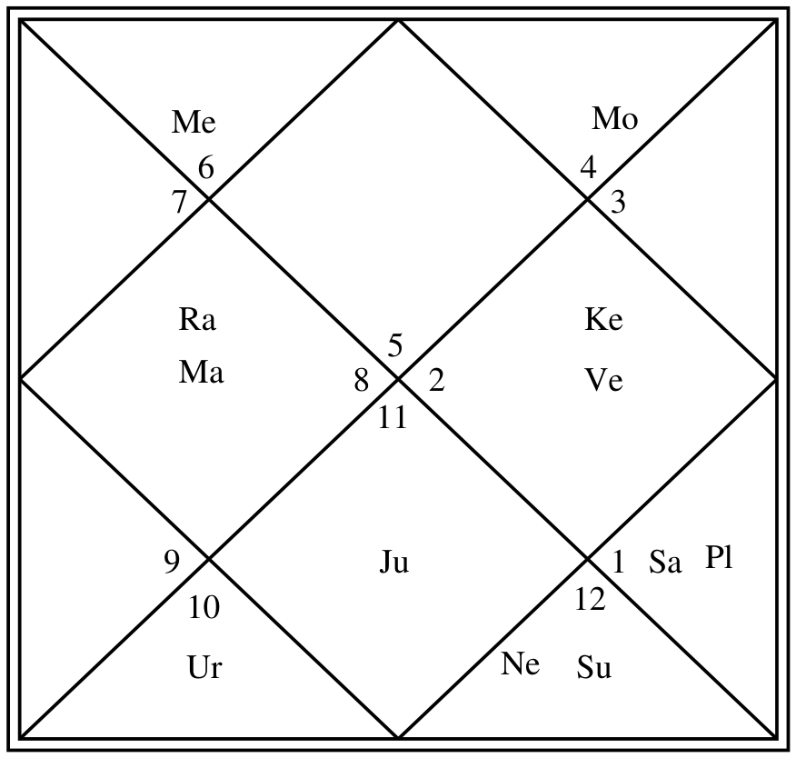

### House & Planetary Placements

| House | Sign / Rashi | Planets Posited |
| :--- | :--- | :--- |
| **House 1 (Ascendant / Lagna)** | 5 — Leo (Simha) | — |
| **House 2 (Dhana)** | 6 — Virgo (Kanya) | Me (Mercury (Budha)) |
| **House 3 (Sahaja)** | 7 — Libra (Tula) | — |
| **House 4 (Sukha / Nadir)** | 8 — Scorpio (Vrishchika) | Ma (Mars (Mangal)), Ra (Rahu (North Node)) |
| **House 5 (Putra)** | 9 — Sagittarius (Dhanu) | — |
| **House 6 (Ripu)** | 10 — Capricorn (Makara) | Ur (Uranus) |
| **House 7 (Jaya / Descendant)** | 11 — Aquarius (Kumbha) | Ju (Jupiter (Guru)) |
| **House 8 (Mrityu)** | 12 — Pisces (Meena) | Su (Sun (Surya)), Ne (Neptune) |
| **House 9 (Dharma)** | 1 — Aries (Mesha) | Sa (Saturn (Shani)), Pl (Pluto) |
| **House 10 (Karma / Midheaven)** | 2 — Taurus (Vrishabha) | Ve (Venus (Shukra)), Ke (Ketu (South Node)) |
| **House 11 (Labha)** | 3 — Gemini (Mithuna) | — |
| **House 12 (Vyaya)** | 4 — Cancer (Karka) | Mo (Moon (Chandra)) |

---

## 20. Trimshamsha - Misfortune — Page 43 

- **Chart Name**: **Trimshamsha - Misfortune**
- **Section / System**: Shodashvarga Charts
- **Page**: 43
- **Detection Method**: `vector_kundli_detector`

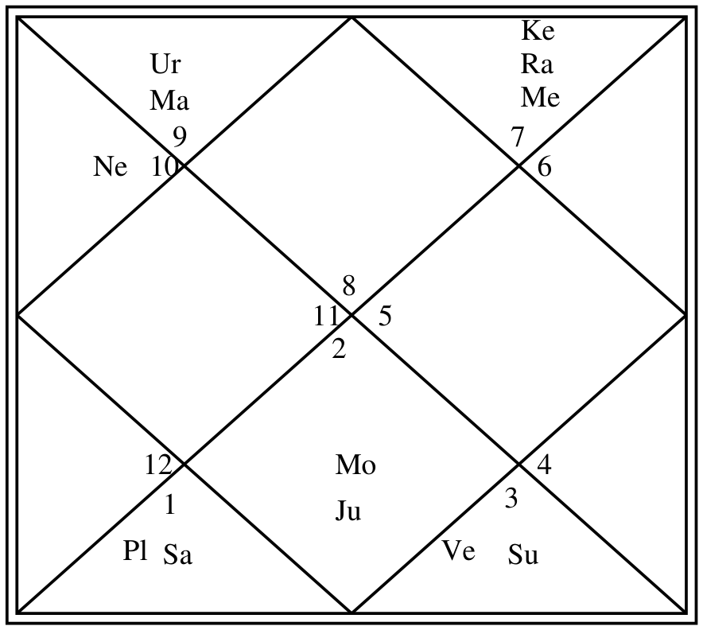

### House & Planetary Placements

| House | Sign / Rashi | Planets Posited |
| :--- | :--- | :--- |
| **House 1 (Ascendant / Lagna)** | 8 — Scorpio (Vrishchika) | — |
| **House 2 (Dhana)** | 9 — Sagittarius (Dhanu) | Ma (Mars (Mangal)), Ur (Uranus) |
| **House 3 (Sahaja)** | 10 — Capricorn (Makara) | Ne (Neptune) |
| **House 4 (Sukha / Nadir)** | 11 — Aquarius (Kumbha) | — |
| **House 5 (Putra)** | 12 — Pisces (Meena) | — |
| **House 6 (Ripu)** | 1 — Aries (Mesha) | Sa (Saturn (Shani)), Pl (Pluto) |
| **House 7 (Jaya / Descendant)** | 2 — Taurus (Vrishabha) | Mo (Moon (Chandra)), Ju (Jupiter (Guru)) |
| **House 8 (Mrityu)** | 3 — Gemini (Mithuna) | Su (Sun (Surya)), Ve (Venus (Shukra)) |
| **House 9 (Dharma)** | 4 — Cancer (Karka) | — |
| **House 10 (Karma / Midheaven)** | 5 — Leo (Simha) | — |
| **House 11 (Labha)** | 6 — Virgo (Kanya) | — |
| **House 12 (Vyaya)** | 7 — Libra (Tula) | Me (Mercury (Budha)), Ra (Rahu (North Node)), Ke (Ketu (South Node)) |

---

## 21. Khavedamsha - Auspicious Results — Page 43 

- **Chart Name**: **Khavedamsha - Auspicious Results**
- **Section / System**: Shodashvarga Charts
- **Page**: 43
- **Detection Method**: `vector_kundli_detector`

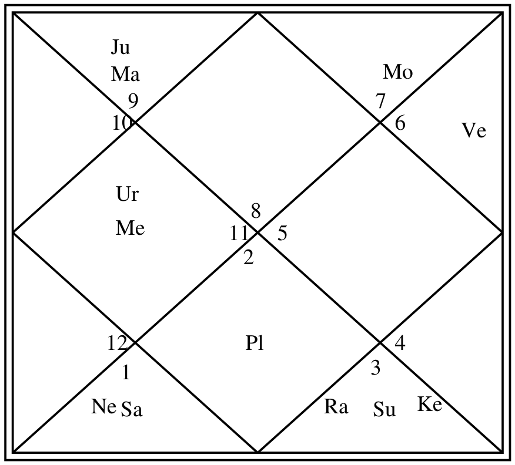

### House & Planetary Placements

| House | Sign / Rashi | Planets Posited |
| :--- | :--- | :--- |
| **House 1 (Ascendant / Lagna)** | 8 — Scorpio (Vrishchika) | — |
| **House 2 (Dhana)** | 9 — Sagittarius (Dhanu) | Ma (Mars (Mangal)), Ju (Jupiter (Guru)) |
| **House 3 (Sahaja)** | 10 — Capricorn (Makara) | — |
| **House 4 (Sukha / Nadir)** | 11 — Aquarius (Kumbha) | Me (Mercury (Budha)), Ur (Uranus) |
| **House 5 (Putra)** | 12 — Pisces (Meena) | — |
| **House 6 (Ripu)** | 1 — Aries (Mesha) | Sa (Saturn (Shani)), Ne (Neptune) |
| **House 7 (Jaya / Descendant)** | 2 — Taurus (Vrishabha) | Pl (Pluto) |
| **House 8 (Mrityu)** | 3 — Gemini (Mithuna) | Su (Sun (Surya)), Ra (Rahu (North Node)), Ke (Ketu (South Node)) |
| **House 9 (Dharma)** | 4 — Cancer (Karka) | — |
| **House 10 (Karma / Midheaven)** | 5 — Leo (Simha) | — |
| **House 11 (Labha)** | 6 — Virgo (Kanya) | Ve (Venus (Shukra)) |
| **House 12 (Vyaya)** | 7 — Libra (Tula) | Mo (Moon (Chandra)) |

---

## 22. Akshvedamsha - Well Being — Page 43 

- **Chart Name**: **Akshvedamsha - Well Being**
- **Section / System**: Shodashvarga Charts
- **Page**: 43
- **Detection Method**: `vector_kundli_detector`

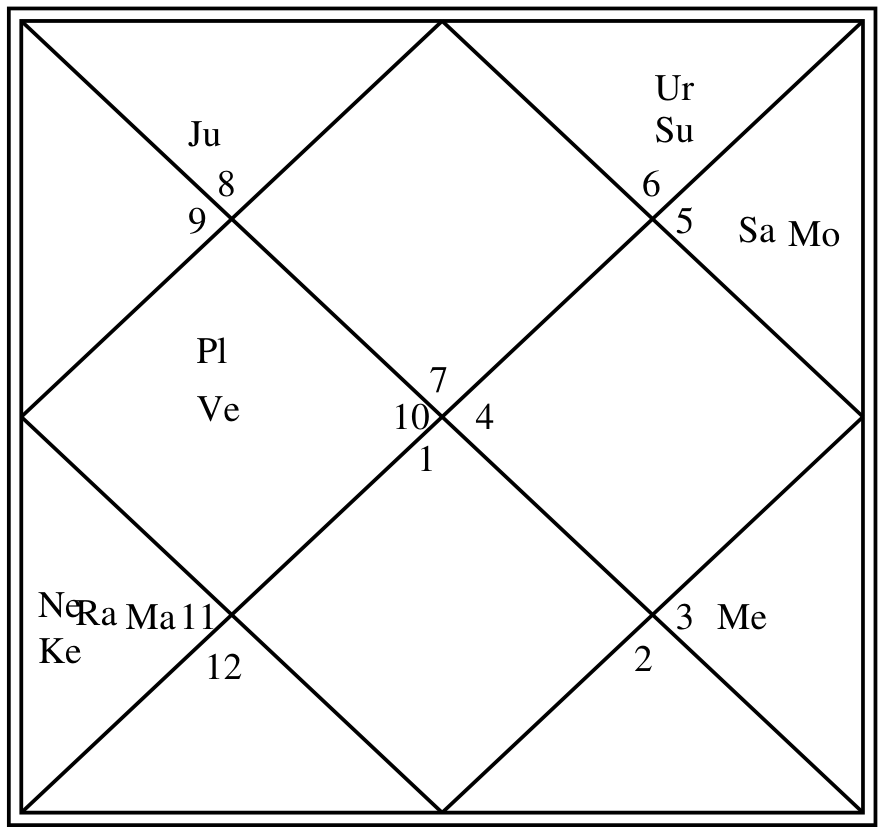

### House & Planetary Placements

| House | Sign / Rashi | Planets Posited |
| :--- | :--- | :--- |
| **House 1 (Ascendant / Lagna)** | 7 — Libra (Tula) | — |
| **House 2 (Dhana)** | 8 — Scorpio (Vrishchika) | Ju (Jupiter (Guru)) |
| **House 3 (Sahaja)** | 9 — Sagittarius (Dhanu) | — |
| **House 4 (Sukha / Nadir)** | 10 — Capricorn (Makara) | Ve (Venus (Shukra)), Pl (Pluto) |
| **House 5 (Putra)** | 11 — Aquarius (Kumbha) | Ma (Mars (Mangal)), Ra (Rahu (North Node)), Ke (Ketu (South Node)), Ne (Neptune) |
| **House 6 (Ripu)** | 12 — Pisces (Meena) | — |
| **House 7 (Jaya / Descendant)** | 1 — Aries (Mesha) | — |
| **House 8 (Mrityu)** | 2 — Taurus (Vrishabha) | — |
| **House 9 (Dharma)** | 3 — Gemini (Mithuna) | Me (Mercury (Budha)) |
| **House 10 (Karma / Midheaven)** | 4 — Cancer (Karka) | — |
| **House 11 (Labha)** | 5 — Leo (Simha) | Mo (Moon (Chandra)), Sa (Saturn (Shani)) |
| **House 12 (Vyaya)** | 6 — Virgo (Kanya) | Su (Sun (Surya)), Ur (Uranus) |

---

## 23. Shastiamsha - Well Being — Page 43 

- **Chart Name**: **Shastiamsha - Well Being**
- **Section / System**: Shodashvarga Charts
- **Page**: 43
- **Detection Method**: `vector_kundli_detector`

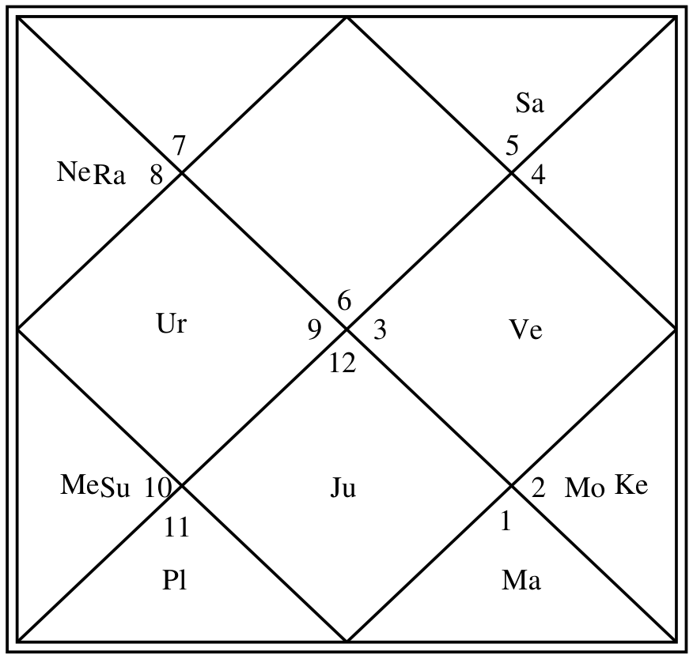

### House & Planetary Placements

| House | Sign / Rashi | Planets Posited |
| :--- | :--- | :--- |
| **House 1 (Ascendant / Lagna)** | 6 — Virgo (Kanya) | — |
| **House 2 (Dhana)** | 7 — Libra (Tula) | — |
| **House 3 (Sahaja)** | 8 — Scorpio (Vrishchika) | Ra (Rahu (North Node)), Ne (Neptune) |
| **House 4 (Sukha / Nadir)** | 9 — Sagittarius (Dhanu) | Ur (Uranus) |
| **House 5 (Putra)** | 10 — Capricorn (Makara) | Su (Sun (Surya)), Me (Mercury (Budha)) |
| **House 6 (Ripu)** | 11 — Aquarius (Kumbha) | Pl (Pluto) |
| **House 7 (Jaya / Descendant)** | 12 — Pisces (Meena) | Ju (Jupiter (Guru)) |
| **House 8 (Mrityu)** | 1 — Aries (Mesha) | Ma (Mars (Mangal)) |
| **House 9 (Dharma)** | 2 — Taurus (Vrishabha) | Mo (Moon (Chandra)), Ke (Ketu (South Node)) |
| **House 10 (Karma / Midheaven)** | 3 — Gemini (Mithuna) | Ve (Venus (Shukra)) |
| **House 11 (Labha)** | 4 — Cancer (Karka) | — |
| **House 12 (Vyaya)** | 5 — Leo (Simha) | Sa (Saturn (Shani)) |

---

## 24. KP System Chart — Page 44 

- **Chart Name**: **KP System Chart**
- **Section / System**: KP System / Nakshatra Nadi
- **Page**: 44
- **Detection Method**: `vector_kundli_detector`

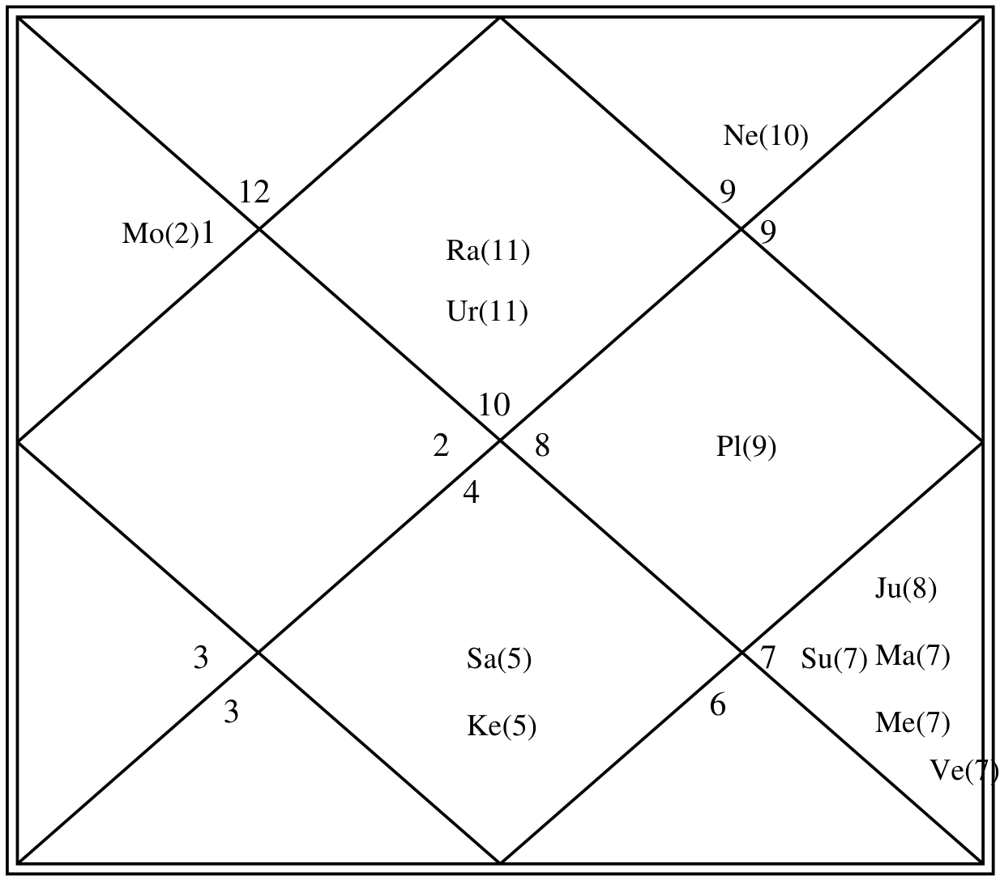

### House & Planetary Placements

| House | Sign / Rashi | Planets Posited |
| :--- | :--- | :--- |
| **House 1 (Ascendant / Lagna)** | 10 — Capricorn (Makara) | Ra(11) (Rahu (North Node)), Ur(11) (Uranus) |
| **House 2 (Dhana)** | 12 — Pisces (Meena) | — |
| **House 3 (Sahaja)** | 1 — Aries (Mesha) | Mo(2) (Moon (Chandra)) |
| **House 4 (Sukha / Nadir)** | 2 — Taurus (Vrishabha) | — |
| **House 5 (Putra)** | 3 — Gemini (Mithuna) | — |
| **House 6 (Ripu)** | 3 — Gemini (Mithuna) | — |
| **House 7 (Jaya / Descendant)** | 4 — Cancer (Karka) | Sa(5) (Saturn (Shani)), Ke(5) (Ketu (South Node)) |
| **House 8 (Mrityu)** | 6 — Virgo (Kanya) | — |
| **House 9 (Dharma)** | 7 — Libra (Tula) | Su(7) (Sun (Surya)), Ma(7) (Mars (Mangal)), Me(7) (Mercury (Budha)), Ju(8) (Jupiter (Guru)), Ve(7) (Venus (Shukra)) |
| **House 10 (Karma / Midheaven)** | 8 — Scorpio (Vrishchika) | Pl(9) (Pluto) |
| **House 11 (Labha)** | 9 — Sagittarius (Dhanu) | — |
| **House 12 (Vyaya)** | 9 — Sagittarius (Dhanu) | Ne(10) (Neptune) |

---

## 25. Ashtakvarga Chart — Page 54 

- **Chart Name**: **Ashtakvarga Chart**
- **Section / System**: Ashtakvarga Table
- **Page**: 54
- **Detection Method**: `vector_kundli_detector`

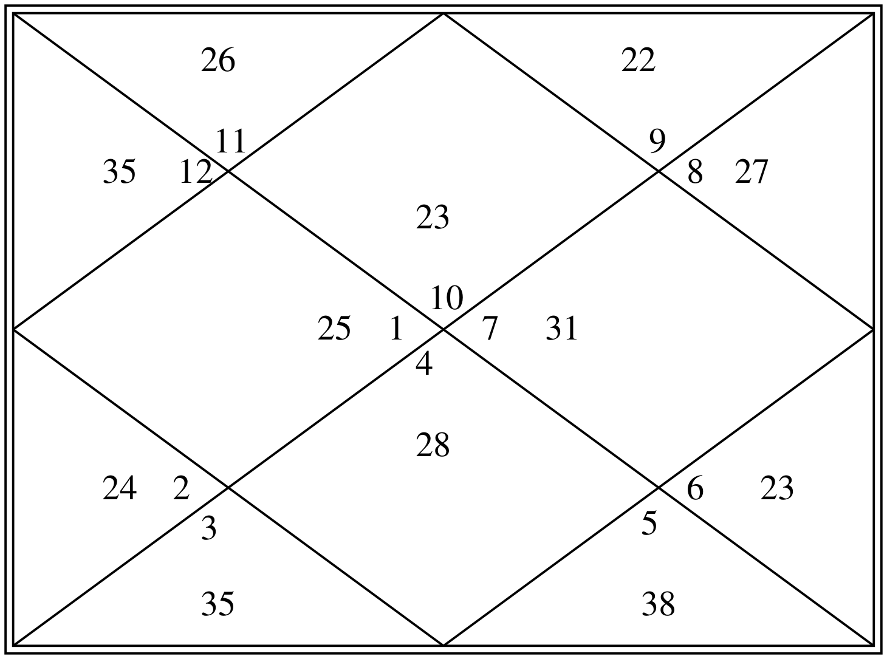

### House & Planetary Placements

| House | Sign / Rashi | Bindus (Points) | Planets Posited |
| :--- | :--- | :--- | :--- |
| **House 1 (Ascendant / Lagna)** | 10 — Capricorn (Makara) | 23 | — |
| **House 2 (Dhana)** | 11 — Aquarius (Kumbha) | 26 | — |
| **House 3 (Sahaja)** | 12 — Pisces (Meena) | 35 | — |
| **House 4 (Sukha / Nadir)** | 1 — Aries (Mesha) | 25 | — |
| **House 5 (Putra)** | 2 — Taurus (Vrishabha) | 24 | — |
| **House 6 (Ripu)** | 3 — Gemini (Mithuna) | 35 | — |
| **House 7 (Jaya / Descendant)** | 4 — Cancer (Karka) | 28 | — |
| **House 8 (Mrityu)** | 5 — Leo (Simha) | 38 | — |
| **House 9 (Dharma)** | 6 — Virgo (Kanya) | 23 | — |
| **House 10 (Karma / Midheaven)** | 7 — Libra (Tula) | 31 | — |
| **House 11 (Labha)** | 8 — Scorpio (Vrishchika) | 27 | — |
| **House 12 (Vyaya)** | 9 — Sagittarius (Dhanu) | 22 | — |

---
